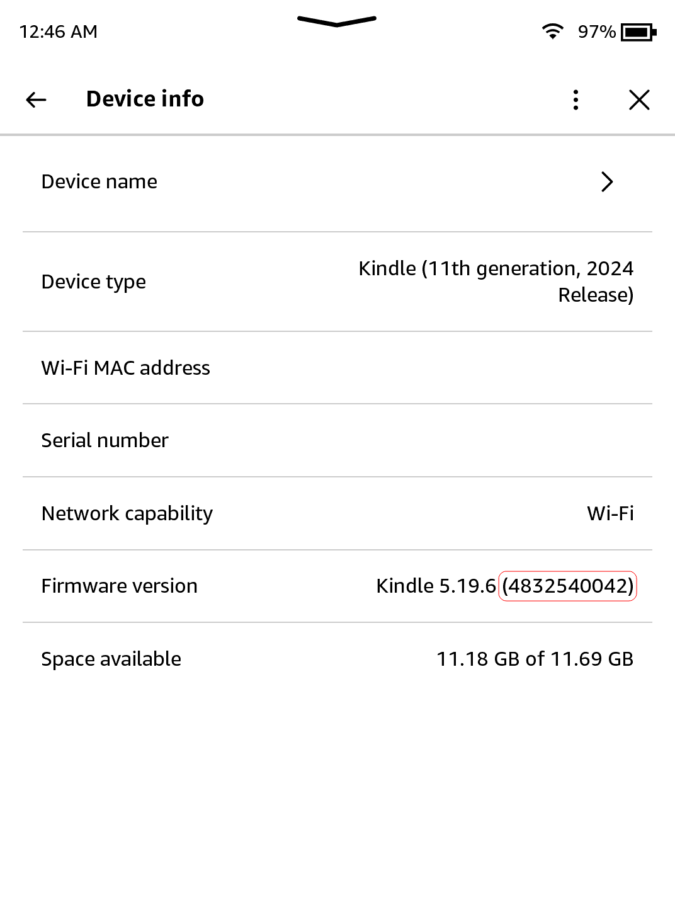
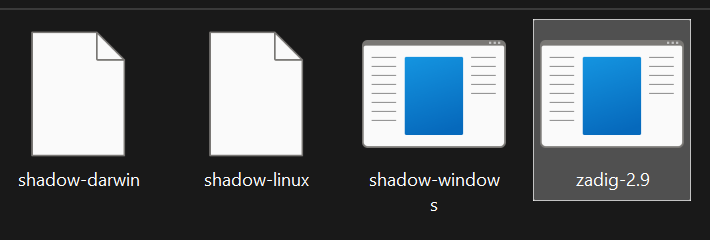
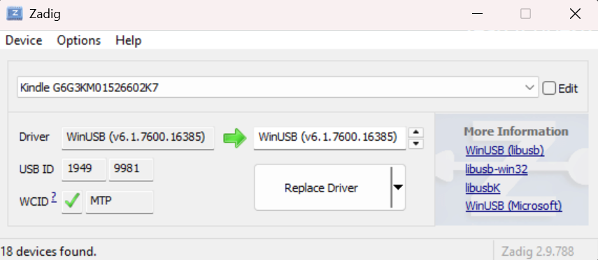
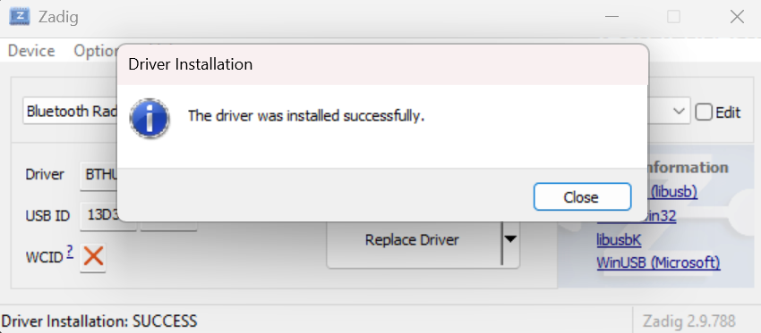
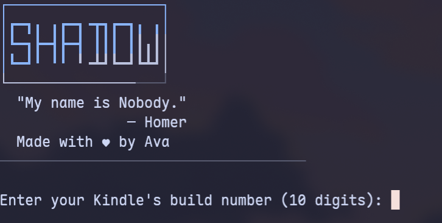
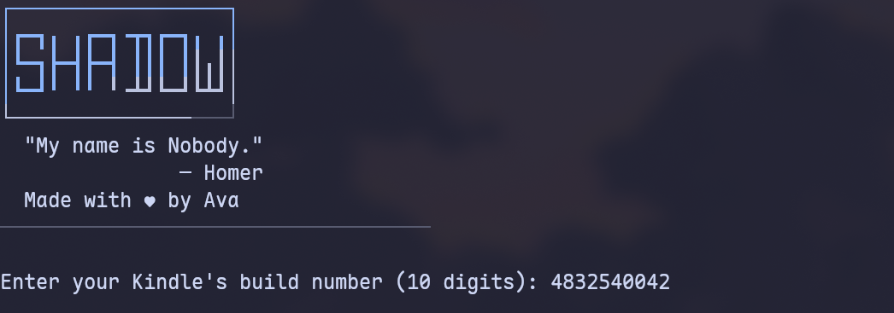
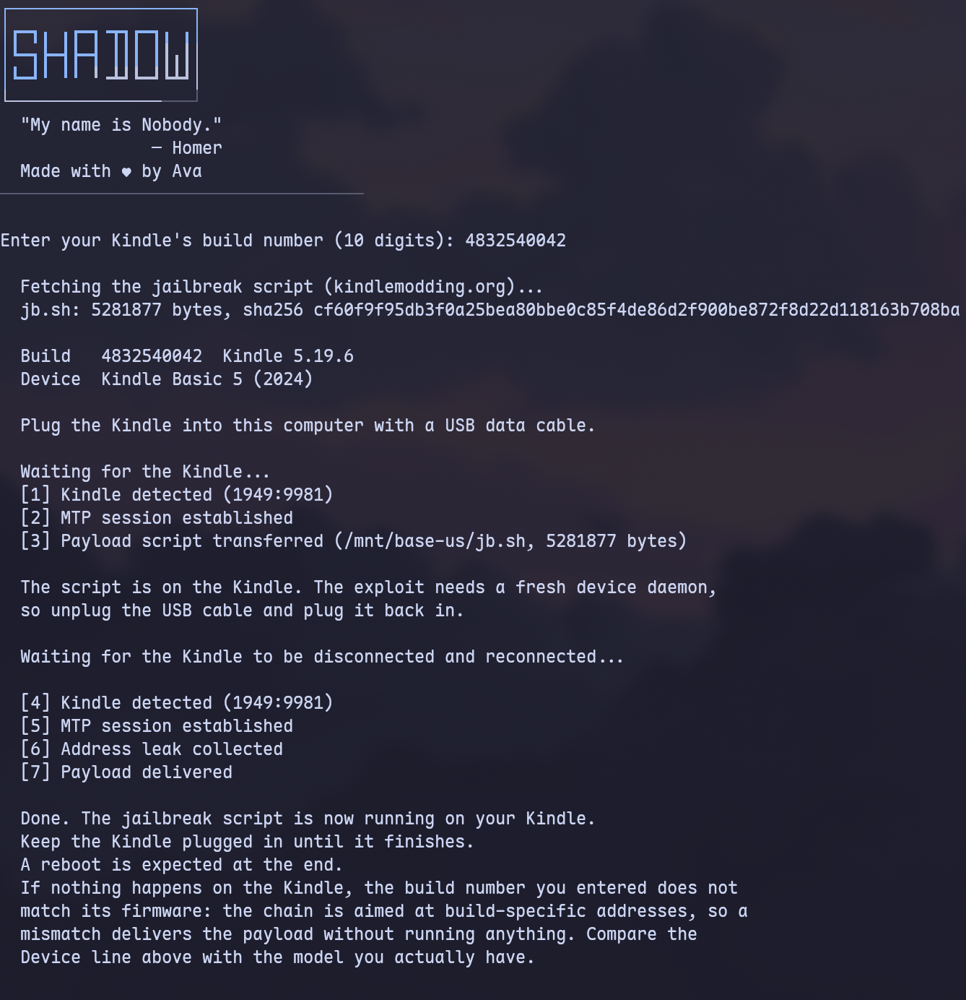

# Shadow

> My name is Nobody.
>  
> \- Homer

Shadow is a jailbreak released on 26/10/2026 by [Ava](https://ko-fi.com/yubaix).

You can read the writeup [here](https://chirp.tene7.com/?action=view&url=shadow-dummy-folders-an-obvious-overflow-and-a-rop-chain).

## Prerequisites

- A PC, Kindle.
- A supported model and firmware, as you have been led here by the <b><a href="/jailbreak-wizard.html">Jailbreaking Wizard</a></b>.
- You have read <a href="/jailbreaking">this overview</a>.
- A Wi-Fi connection on your computer.

> [!INFO]
> If you face any difficulty in following these guides, please navigate to the [troubleshooting](#troubleshooting) section, and/or make a ticket in the KindleModding Discord support forums.

## Installation Guide

    

        <button id="prev">Previous Step</button>
        
        <button id="next">Next Step</button>
    

    

        

            <h2>Download the latest Shadow release</h2>
            

            <a href="https://github.com/KindleModding/Shadow/releases/latest/download/shadow.zip" class="button">Download</a>
                

                    
On the contrary to other jailbreaks, <i>Filler files are not necessary!</i> This is because your Kindle never has to connect to the internet during the jailbreak. They will not make it fail either, so deleting filler files that are already present is also not necessary.

                

                

                    <b>Warning!</b> 
                    
Enabling airplane mode is still recommended during the jailbreak process to prevent updates!

                

                
If you have done the above, please commence to the next step.

            

        

        

            <h2>Note your device's build number</h2>
            

              
On your Kindle, open the device info menu. (<code>3 Dots → Settings → Device options → Device info </code>)

                
Note down your exact build number for later. This is the 10 digit number in parentheses in the settings menu.

                

                    The specific value should be the one after both "Kindle" and after the number with dots in between multiple numbers.
                

                
                
Exit out of the menu by clicking the X in the top right.

            

        

        

            <h2>Ensure MTP compatibility</h2>
            

                

                    
Windows:

                    
Follow steps 4-6 to setup Zadig.

                

                

                    
Linux:

                    
Open a terminal, and run <code>killall kiod6 kiod5 gvfsd-mtp</code>. Additionally, close any file managers you have open (Dolphin, Nautilus, etc).

                

                

                    
MacOS:

                    
Open a terminal, and run<code>killall ptpcamerad</code>. Additionally, close any file managers you have open, such as Finder.

                

                
If you are not on Windows, you may skip to step 7 at this point. If you are on Windows, please follow steps 4-6.
            

        

        

            <h2>Open Zadig</h2>
            

                
If you have not done so already, unzip the .zip file you previously downloaded.

                
<b>Do not open Shadow yet,</b>instead, open <code>zadig-2.9.exe</code>

                
            

        

        

            <h2>Select the Kindle and driver</h2>
            

                
Plug your Kindle into your computer.

                
At the top of Zadig, click options, and then click "Show all Devices"

                
In the dropdown menu immediately below the top bar, find and select your Kindle.

                
After selecting your Kindle, click the down arrow to the right side of the right box until that box says "WinUSB".

                
Once all is done correctly, your Zadig menu should look something like the image below:

                
            

        

        

            <h2>Replace the driver</h2>
            

                
Click "Replace driver" or "Install driver" and wait for the process to complete.

                
This can take a few minutes. Once complete, a box will show up. Click "OK."

                
Then, unplug and replug your Kindle into your computer. Once this is done, you may close Zadig.

                

                    <b>Warning!</b> 
                    
Restoring the driver via Zadig is difficult and flaky. Because of this, <b>until you reboot your computer</b>, you will not be able to transfer files over USB to your Kindle. No permanent changes are made, and everything is set back to normal after a reboot.

                

                
            

        

        

            <h2>Open Shadow!</h2>
            

                

                    
Windows:

                    
Double click "shadow-windows.exe".

                

                

                    
Linux:

                    
Open a terminal in the folder where you extracted the Shadow release, and run <code>chmod +x shadow-linux && sudo ./shadow-linux</code>

                    
Root privileges are needed to run this, as root is required to talk to devices over USB.

                

                

                    
MacOS:

                    
Open a terminal in the folder where you extracted the Shadow release, and run <code>chmod +x shadow-darwin && sudo ./shadow-darwin</code>

                

                
            

        

        

            <h2>Enter in your build number</h2>
            

                
In the application, enter in your ten-digit build number from before. Ensure that it matches exactly, as the exploit may not run otherwise.

                
            

        

        

            <h2>Jailbreak!</h2>
            

                
After ensuring your build number matches the build number from before <b>exactly</b>, hit enter.

                
When prompted, unplug your Kindle, wait a second or two, and then re-plug your Kindle.

                

                    There is a small chance (<1%) that an error message will appear saying that "The exploit did not get a clean address leak this attempt." -- If this happens, try again from the previous step. If this happens repeatedly, join the Discord server for support.
                

                
If all goes well, some text should flow down the top left of your Kindle screen, and the output of Shadow should match the image below.

                
            

        

        

            <h2>After Jailbreaking...</h2>
            

                

                    <b>What's Next?</b> 
                    After the reboot, you may unplug your Kindle, and commence to the <a href="../whats-next">What's Next</a> section to read about installing scriptlets, homebrew, and KOReader. Read the <b>whole section</b> thoroughly.
                

                

                    You may now <b>delete</b> any filler files. Updates have been automatically blocked for you.  
                    Before you do this, also <b>remove any existing update files with a <code>.bin</code> extension</b>, if they exist in the Kindle's root.
                

                

                    Due to how Shadow works, some empty folders are left behind in the base USB folder of your Kindle. These folders are completely harmless, but if you would like to remove them, you may use the <a href="./cleanup-shadow-dirs.sh" download="cleanup-shadow-dirs.sh">provided scriptlet</a>. See the next section for how to use scriptlets, if you are confused.
                

                

                    If you are on Windows, you must reboot your computer in order to restore the MTP driver to access your Kindle over USB.
                

                
Have fun! :)

            

        

    

    

        <button id="prev">Previous Step</button>
        
        <button id="next">Next Step</button>
    

## Troubleshooting

1. "Device busy" or not detecting the Kindle?
    - Ensure that all appropriate killall commands for your operating system were ran, and then close any file managers you may have open.

## Credits

- Thanks to all beta-testers: usag1, scam.net, RumpheL
