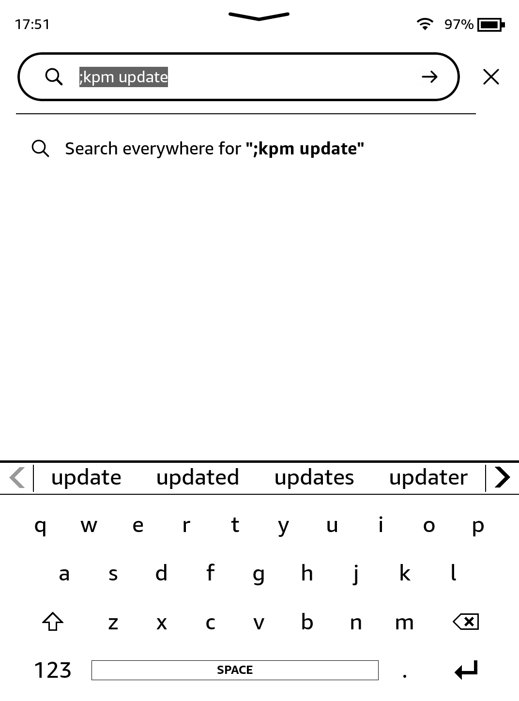
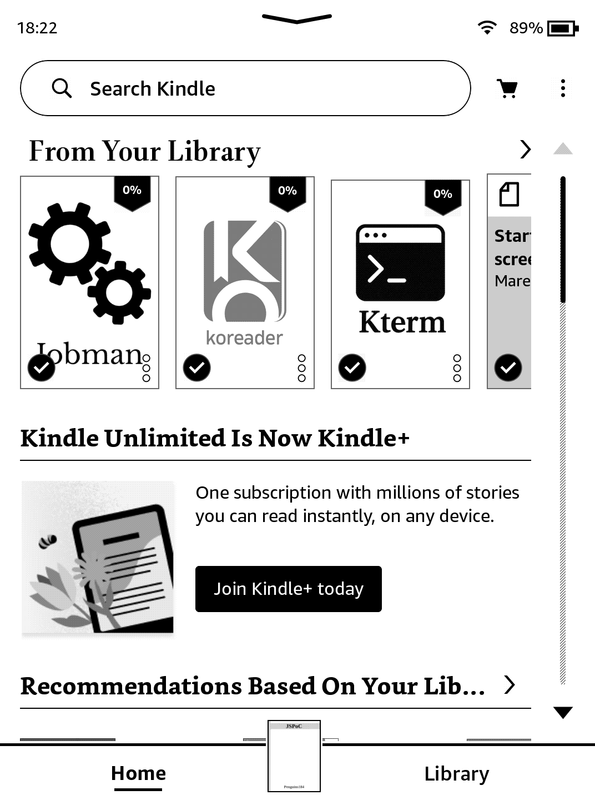
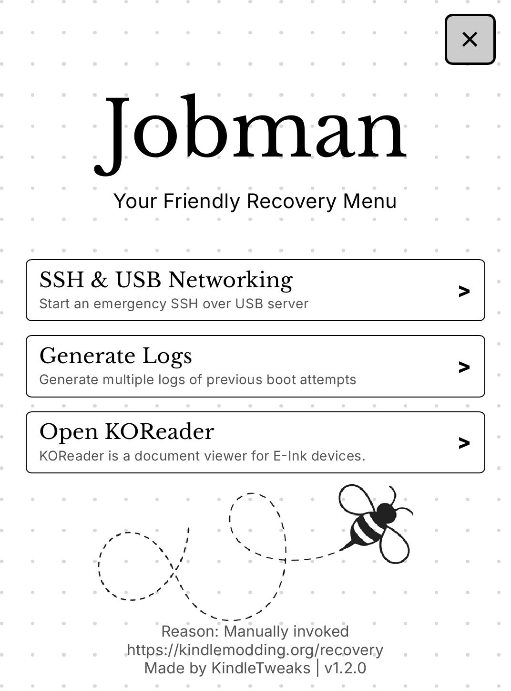

# Jailbreaking Manager

> [!WARNING]
> If you have a Kindle below firmware 5.16.3, move on to [Getting KOReader](../getting-koreader). The Jailbreaking Manager does not support your device.

[Jobman](https://github.com/KindleTweaks/Jobman) is a jailbreaking manager developed by the [KindleTweaks](https://discord.gg/aSG3eMsAsW) team.

It allows you to:

- Manage the blocking, and unblocking of updates
- Update the jailbreaking environment if necessary (note that this is rarely needed, but can be useful)
- Tell you your battery health ([coulomb counting](https://www.sciencedirect.com/topics/engineering/coulomb-counting))
- Run SSH over USB and Wi-Fi
- Can enable **recovery** on boot (<i>if you choose to</i>), potentially mitigating bricks.

    

        <button id="prev">Previous Step</button>
        
        <button id="next">Next Step</button>
    

    

        

            <h2>Reboot</h2>
            

                
If you have just jailbroken, and have not yet rebooted, <b>Reboot Now.</b>
 
After this, ensure Wi-Fi is <b>enabled</b> on your device.

            

        

        

            <h2>Update Sources</h2>
            

                
Run <code>;kpm update</code> in the searchbar on the homescreen (and press return/enter).
 
You will see some text at the top of the screen, before you're returned to the homepage.

                
            

        

        

            <h2>Install</h2>
            

                
Now, run <code>;kpm install jobman</code> in the searchbar.
 
Wait a few moments, you'll be returned to the homescreen and a new Scriptlet will have appeared (the icon may not instantly appear).

                
            

        

        

            <h2>Run!</h2>
            

                
Click on it, and Jobman will run! Alternatively, you can also run <code>;kpm launch jobman</code> to use it.

                

                    <b>Psst!</b> 
                    This is an image of <b>jobman recovery</b>. If you'd like to install it or learn more, head over <a href="../../faq/kindle-recovery.html">here</a>. This is entirely optional, and keep in mind recovery mode is <b>highly experimental</b>!
                

                
            

        

        

            <h2>Uninstallation</h2>
            

                
If you ever wish to uninstall it, simply run <code>;kpm uninstall jobman</code> (this will also uninstall recovery, if enabled). Simple!  All KPM packages are installed in this way. You'll see almost exactly the same thing when you get onto installing KOReader.

            

        

    

    

        <button id="prev">Previous Step</button>
        
        <button id="next">Next Step</button>
    

