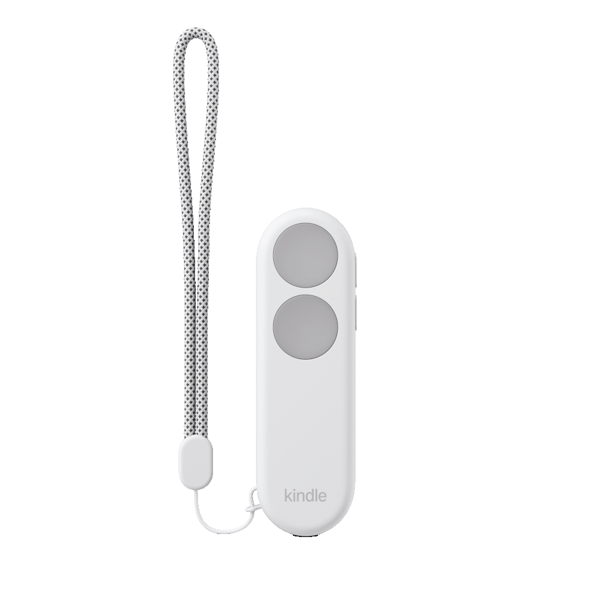

# Kindle Click



Kindle Click is a page turning remote announced on 1st October 2026 for $35.  

Features:
- Forward
- Backward
- Brightness increase/decrease
- Sleep

The device is internally referred to as `kindleremote`.

## HID
The Kindle Click is a HOGP (HID over GATT Profile) device.  
Battery life is reported via a standard BLE battery service (`0x180F`). `(needs confirming)`

## Discovery
The Kindle detects the Kindle remote as a HID device with a vendor ID of `0x0171` and a product ID of `0x0443`.

## Control
The Kindle Click sends standard HID keycodes for each action:
| Action          | Key                |
|-----------------|--------------------|
| Page Forward    | KEY_PAGEDOWN       |
| Page Back       | KEY_PAGEUP         |
| Brightness Up   | KEY_BRIGHTNESSUP   |
| Brightness Down | KEY_BRIGHTNESSDOWN |
| Sleep           | KEY_POWER          |

## OS Implementation
The device is handled by `/usr/bin/acsbtfd` which performs the main pairing, discovery, and HID logic.  
`/usr/bin/input_manager` handles mapping the inputs (and the vid/pid storage?) and is data-driven, hence the JSON files attached to this page.


## References
Thanks to [Clint](https://github.com/clintharrison/) for confirming these findings with his own RE efforts.

`/etc/input_manager/devices.json`
```json
{
  "devices": [
    {
      "name": "Amazon Kindle Remote",
      "vid": "0x0171",
      "pid": "0x0443",
      "category": "page_turner",
      "match_type": "vid_pid"
    }
  ]
}
```


`/etc/input_manager/categories.json`
```json
{
  "categories": {
    "page_turner": {
      "virtual_device": {
        "name": "kindle-input-pt",
        "vendor_id": "0x0001",
        "product_id": "0x0001"
      },
      "pipeline_stages": ["capability_filter", "orientation_swap", "debounce", "rate_limiter"],
      "trigger_detection": false,
      "debounce_window_ms": 50,
      "rate_limit_events_per_sec": 100,
      "rate_limit_burst_size": 10,
      "capability_table": [
        "KEY_PAGEDOWN",
        "KEY_PAGEUP",
        "KEY_BRIGHTNESSUP",
        "KEY_BRIGHTNESSDOWN",
        "KEY_POWER"
      ],
      "semantic_names": {
        "nav.page_forward": "KEY_PAGEDOWN",
        "nav.page_back": "KEY_PAGEUP",
        "display.brightness_up": "KEY_BRIGHTNESSUP",
        "display.brightness_down": "KEY_BRIGHTNESSDOWN",
        "system.sleep": "KEY_POWER"
      },
      "default_mappings": [
        {
          "event": "KEY_PAGEDOWN",
          "trigger": "press",
          "target_type": "emit",
          "target": "KEY_PAGEDOWN"
        },
        {
          "event": "KEY_PAGEUP",
          "trigger": "press",
          "target_type": "emit",
          "target": "KEY_PAGEUP"
        },
        {
          "event": "KEY_BRIGHTNESSUP",
          "trigger": "press",
          "target_type": "action",
          "target": "display.brightness_up",
          "dispatch_on": ["press", "repeat"]
        },
        {
          "event": "KEY_BRIGHTNESSDOWN",
          "trigger": "press",
          "target_type": "action",
          "target": "display.brightness_down",
          "dispatch_on": ["press", "repeat"]
        },
        {
          "event": "KEY_POWER",
          "trigger": "press",
          "target_type": "action",
          "target": "system.sleep",
          "dispatch_on": ["press"]
        }
      ],
      "kernel_repeat": {
        "delay_ms": 500,
        "period_ms": 333
      },
      "orientation_swap_pairs": [
        {
          "event1": "nav.page_forward",
          "event2": "nav.page_back",
          "swap_on": [180]
        }
      ],
      "storage_backend": "gkeyfile",
      "max_devices": 16,
      "max_overrides": 8,
      "max_action_queue_depth": 32
    }
  }
}
```